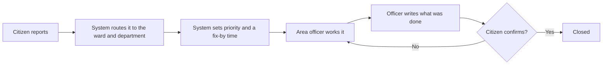
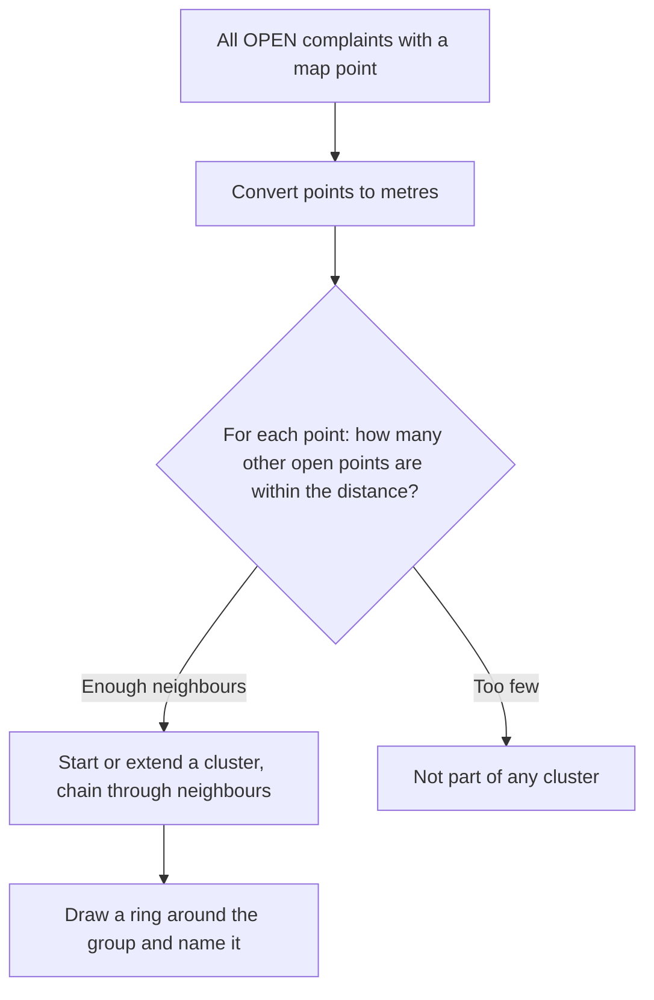
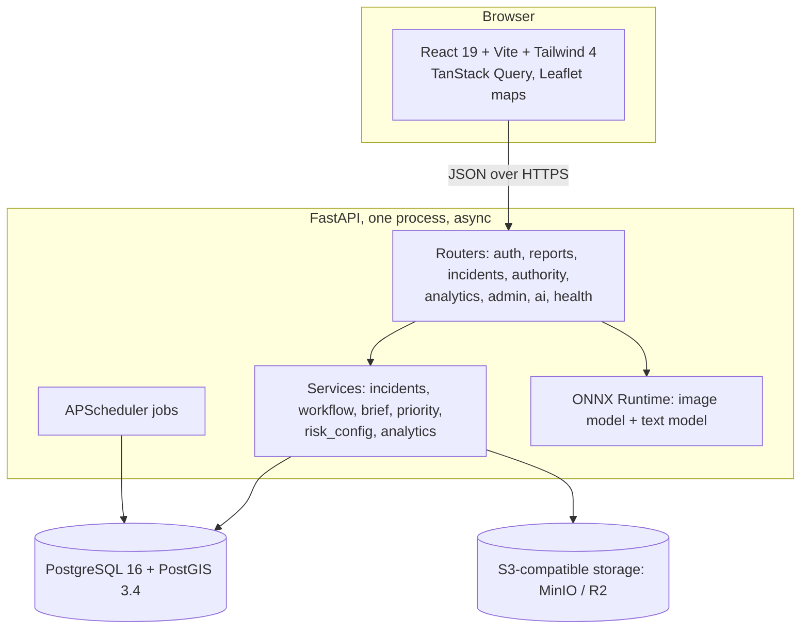
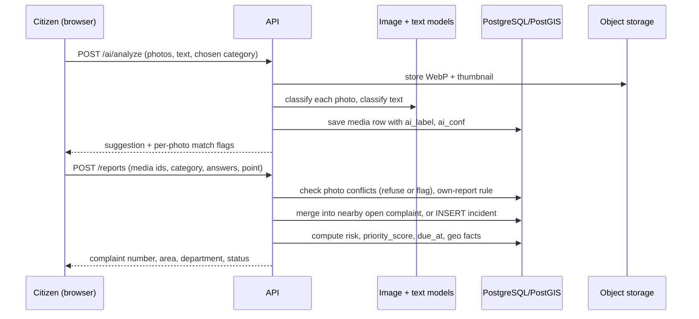

# iREPORT: the complete project guide

How a civic problem travels from a citizen's phone to a closed job, what every number and chart means, how clusters work, and how the system is built.

This guide has two parts. **Part A** needs no technical background. **Part B** is for engineers and reviewers. The short README is the quick start; this is the full explanation.

---

## Contents

**Part A: for everyone**
1. [What iREPORT is, in one minute](#1-what-ireport-is-in-one-minute)
2. [Who uses it](#2-who-uses-it)
3. [How a problem gets solved: the full journey](#3-how-a-problem-gets-solved-the-full-journey)
4. [Priority: why one problem comes before another](#4-priority-why-one-problem-comes-before-another)
5. [Deadlines and "overdue"](#5-deadlines-and-overdue)
6. [Clusters and hotspots, explained simply](#6-clusters-and-hotspots-explained-simply)
7. [Every percentage and number, explained](#7-every-percentage-and-number-explained)
8. [Every chart, explained](#8-every-chart-explained)
9. [What the system does not do](#9-what-the-system-does-not-do)

**Part B: for engineers**
10. [Architecture](#10-architecture)
11. [The data model](#11-the-data-model)
12. [What happens to one report, step by step](#12-what-happens-to-one-report-step-by-step)
13. [The two AI models](#13-the-two-ai-models)
14. [The priority formula](#14-the-priority-formula)
15. [Clustering in detail](#15-clustering-in-detail)
16. [Duplicate handling and the one-report-per-spot rule](#16-duplicate-handling-and-the-one-report-per-spot-rule)
17. [Access control: who can see and change what](#17-access-control-who-can-see-and-change-what)
18. [Analytics and the admin dashboard: exact definitions](#18-analytics-and-the-admin-dashboard-exact-definitions)
19. [Background jobs](#19-background-jobs)
20. [Security and privacy](#20-security-and-privacy)
21. [Testing](#21-testing)
22. [Known limits](#22-known-limits)
23. [Glossary](#23-glossary)

---

# Part A: for everyone

## 1. What iREPORT is, in one minute

A citizen sees a pothole, a pile of garbage, a broken streetlight, a hanging wire or a flooded road. They open iREPORT, pick the problem, add a photo and mark the spot on a map. That takes under a minute.

iREPORT then does the work that normally gets lost between people:

- it works out **which ward and department** is responsible,
- it works out **how dangerous** the problem is and sets a **fix-by time**,
- it puts the problem at the right place in the **officer's queue**,
- it lets the citizen **follow progress** and **confirm** the fix.

The officer sees the most urgent problems first, with a photo, a map pin and a one-line reason. The admin sees the whole city on one dashboard.



## 2. Who uses it

| Person | What they do | What they see |
|---|---|---|
| **Citizen** | Reports problems, adds photos, confirms or reopens a fix | Their own reports and the progress of each; nearby open problems |
| **Area authority (officer)** | Works the complaints of one **area and department** | Only their own area's complaints, a map, counts, an analysis of their area |
| **Admin** | Approves officers and watches the whole city | Every complaint in Mumbai (read only), the city dashboard, officer workload |

An officer **cannot see or change another area's or department's complaints**. To work in another area they must sign in as that area's authority. This is enforced by the server, not just hidden on screen.

## 3. How a problem gets solved: the full journey

### Step by step (non-technical)

1. **The citizen reports.** They choose up to three problems at one place. The first is the **Main problem**; the others are filed with it. They add up to three photos per problem and mark the exact spot (GPS, photo location, or tapping the map).
2. **The photo is checked.** A small image model looks at each photo. If it is **sure** the photo shows something else (or no civic problem at all), the photo is refused and the citizen is asked to remove it and upload a clear one. If it is only **unsure**, the report is accepted but flagged for an officer to review.
3. **The system routes the report.** The pin gives the **area (ward)**. The category gives the **department**: potholes and road damage go to Roads & Traffic, garbage to Solid Waste Management, electrical hazards to Electrical Safety, waterlogging and drains to Storm Water Drains, streetlights to Street Lighting, everything else to the General / Ward Office.
4. **Repeats are merged.** If someone already reported the same kind of problem within 50 metres, the new report joins that complaint instead of creating a second one. The complaint then shows "reported by 3 citizens", which also raises its priority.
5. **Priority and deadline are set.** The system works out a risk score (section 4) and a **fix-by time** (section 5). Critical problems must be fixed in 24 hours.
6. **The officer acts.** They see the problem in their queue, most dangerous first. The main button always shows the next step: **Acknowledge**, then **Start work**, then **Mark resolved**. Other actions (schedule a visit, put on hold, reject, mark duplicate, transfer to the right department) sit under **More**.
7. **The officer explains the fix.** "Mark resolved" asks for a short note on what was done. The citizen sees that note. Resolving is always one complaint at a time, never in bulk.
8. **The citizen confirms.** They press **Confirm** (the complaint is **Closed**) or **Reopen** with a reason (it returns to the queue and keeps its original deadline). If the citizen does not answer in **72 hours**, it closes automatically.

### Where the officer works

| Screen | What it is for |
|---|---|
| **Control room, Complaints** | The list of problems in the officer's area, most urgent first, with status chips and priority chips |
| **Map** | Every open problem in the area, coloured by priority, with rings where problems cluster |
| **Complaint view** | One problem on one page: what, how urgent, fix-by time, photos, map, history, messages, next action |
| **Analysis** | Charts and findings about the officer's own area |
| **Print work order** | A one-page sheet for the crew, with blank fields for work done and signatures |

### Statuses

| Status | Meaning |
|---|---|
| Reported | New. Nobody has acted yet |
| Acknowledged | An officer has seen it and owns it |
| Scheduled | A visit or work date is set |
| In progress | A crew is working on it |
| Resolved (shown as "Awaiting verification") | The officer says it is fixed. Waiting for the citizen |
| Closed | The citizen confirmed, or 72 hours passed with no answer |
| Reopened | The citizen says it is not fixed |
| On hold / Rejected / Duplicate / Transferred | Side exits. Each needs a reason (or the original complaint number, or the correct category) |

"Open" means Reported, Acknowledged, Scheduled, In progress, Reopened or On hold. Every screen and every count uses this one definition.

## 4. Priority: why one problem comes before another

Every complaint gets one of four priority labels. The label comes from a **risk value from 1 to 16**:

> **risk = impact × likelihood**   (each from 1 to 4)

| Label | Risk | What it means in plain words | Fix within |
|---|---|---|---|
| **Critical** | 12 to 16 | Can hurt people or vehicles now. Make the site safe first, then repair | 24 hours |
| **High risk** | 8 to 11 | Serious damage or many people affected. Inspect and schedule the repair | 3 days |
| **Moderate risk** | 4 to 7 | Needs repair but is not dangerous now. Schedule in normal work | 14 days |
| **Routine** | 1 to 3 | Planned maintenance | 30 days |

**Impact** is how bad the harm could be, decided by the type of problem:

| Impact | Type of problem | Why |
|---|---|---|
| 4 | Electrical hazard | Life-safety: live wire, electrocution risk |
| 3 | Pothole, road damage, drainage, water leakage | Injury or vehicle damage |
| 2 | Garbage, streetlight | Health or safety nuisance |
| 1 | Other | Inconvenience |

If the reporter describes the problem as **dangerous**, impact goes up by one level (never down).

**Likelihood** is how likely harm is. It starts at 1 and gains **one point for each** of these facts, up to a maximum of 4:

- the problem is **on a main road** (within 30 m of one on the map),
- a **school or hospital** is within 100 m,
- **three or more different citizens** reported or confirmed it,
- it is **monsoon season** (June to September) and the problem is a road or water problem,
- it is a **night-time hazard**, or an open streetlight-out complaint is within 100 m.

Each reason shown on the complaint says **where it came from**: *checked on map*, *citizen says*, *complaint records*, *calendar* or *category*. The score is never shown as the decision; the label and the reasons are.

**Worked example.** A large pothole (impact 3) on a main road (+1), reported by 3 citizens (+1), in monsoon (+1): likelihood 4, risk 12, so **Critical**, fix within 24 hours.

## 5. Deadlines and "overdue"

> **Fix-by time = time reported + the time allowed for its priority level.**

A Critical complaint reported at 2:31 pm on 8 October must be fixed by 2:31 pm on 9 October.

- **Overdue** means the complaint is still open and the fix-by time has passed. The screen shows "Overdue by 5 days".
- The fix-by time can only move **earlier** if the priority rises later. A promise already made is never extended.
- A reopened complaint **keeps its original deadline**.
- A complaint transferred to another department restarts its clock with the new category's allowance.
- Hovering over "Fix by" shows the reported time and the deadline.

## 6. Clusters and hotspots, explained simply

There are **two** kinds of grouping. Both answer "where are problems piling up?" and neither predicts the future.

### 6.1 Map clusters (the dashed rings on the map)

> A **cluster** is a group of **at least 2 open problems that are within 300 metres of each other**, chained together.

"Chained" means: if A is within 300 m of B, and B is within 300 m of C, then A, B and C are one cluster even if A and C are further apart. The ring is drawn around the group, so a crew can handle nearby problems in one trip.

Only **open** problems count. Once a problem is resolved it leaves the cluster.

### 6.2 Hotspots (the ranked list)

> A **hotspot** is a group of **at least 3 open problems within 400 metres of each other**, reported in the **last 30 days**.

Hotspots are ranked by an **impact score from 0 to 100**:

> impact score = 60% × (highest priority score in the group) + 40% × (number of open problems × 8, capped at 100)

So a hotspot ranks high if it contains one very dangerous problem, or many problems, or both. It is named after the area that has the most points in the group.

### 6.3 What clustering is, and is not

The method is **DBSCAN**, a standard way of finding dense groups of points. It is unsupervised: nobody trained it on labelled examples, and it has no hidden settings beyond the two numbers above (distance and minimum count). The map says it plainly: *"It shows where problems pile up; it does not predict anything."*



## 7. Every percentage and number, explained

### On a complaint

| You see | Meaning | How it is worked out |
|---|---|---|
| **"looks like Electrical Hazard (96% sure)"** | How confident the image model is in its top label | The model's score for its top class, calibrated so that "90%" is closer to meaning 90 times in 100. It is a suggestion, never a fact |
| **"3 days left" / "Overdue by 2 days"** | Time to the fix-by time, or time past it | Fix-by time minus now |
| **Reported by 3 citizens** | How many different people reported or confirmed it | Distinct people across reports and confirmations (the same person twice counts once) |
| **Priority label** | Critical, High risk, Moderate risk or Routine | From the risk value (section 4) |

### Photo checks (what the percentages decide)

| Model's confidence that the photo shows something else | What happens |
|---|---|
| **60% or more** | The photo is **refused**. The citizen removes it and uploads another |
| **40% to 60%** | The report is **accepted but flagged** "Potentially fake / needs review" |
| **Below 40%, or the photo matches** | Accepted normally |

If the photo and the written description point to different problems, the report is also flagged.

### On the admin dashboard and the analysis

| You see | Meaning | Exact definition |
|---|---|---|
| **Open complaints** | Complaints still being worked | Status is open (section 3) |
| **Critical and high risk** | Open complaints with risk 8 or more | Counted from the risk value |
| **Overdue** | Open complaints past their fix-by time | Open and now is after the deadline |
| **Waiting to be acknowledged** | New complaints no officer has acted on | Status Reported or Reopened |
| **Resolved %** | Share of valid complaints an officer has resolved | Resolved ÷ (all complaints − rejected − duplicates) |
| **Fixed on time %** | Of the fixed complaints, how many were done by the deadline | Resolved on or before the deadline ÷ all resolved |
| **Typical fix time** | The middle value of time from report to resolved | Median of (resolved time − reported time) |
| **Reopened %** | Of the fixed complaints, how many the citizen reopened | Resolved complaints with a reopen ÷ all resolved |
| **New in 7 days** | Complaints received in the last 7 days | With "+n vs last week" against the 7 days before |
| **Waiting for citizen** | Resolved, citizen has not answered yet | Status Resolved |
| **Impact score /100** | How serious a hotspot is | Section 6.2 |
| **Share % in the problem-type chart** | How much of the open work each type is | Open complaints of that type ÷ all open complaints |

Every figure is a plain count of records in the database. Nothing on the admin dashboard is estimated or predicted.

## 8. Every chart, explained

| Chart | What it shows | How to read it | Takeaway sentence |
|---|---|---|---|
| **Weekly workload** (line chart, admin and analysis) | New complaints received each week (blue) and complaints finished each week (green), for the last 12 weeks | If blue is above green, work is arriving faster than it is being finished and the backlog is growing. Weeks run Monday to Sunday, India time | "This week: 163 new complaints received, 37 finished" |
| **Priority** (bars) | Open complaints at each of the four priority levels | Longer bars mean more work at that level | "25 open complaints are critical or high risk" |
| **Problem types** (bars) | Open complaints by type | The longest bar is the most common problem | "Pothole is the most common open problem (40 of 229)" |
| **Areas** (bars) | The areas with the most open complaints, with their overdue count | Where the work is piling up | "Sion has the most open complaints (17)" |
| **Departments** (table) | Open work, high-risk, overdue, resolved and on-time rate per department | A low on-time rate means that department is falling behind | |
| **Hotspots** (ranked list) | Dense groups of open problems | Higher impact score means more urgent | |
| **Officers** (table) | Open, overdue and resolved complaints per officer, and typical fix time | Red numbers are overdue complaints | |
| **Backlog / season** (analysis, optional) | Open work over time, and complaints per month by type | Shows trends and seasonal peaks such as the monsoon | |

Every chart has a one-sentence title that states the finding, a text summary for screen readers, and the same numbers available as a table.

## 9. What the system does not do

- It does **not** predict where problems will happen. Clusters and hotspots only describe the problems already reported.
- It does **not** let the AI decide anything. Priority, deadlines and counts come from fixed, published rules. The image model only suggests a category and screens photos.
- It does **not** assign work to named officers by hand. The area authority is responsible; the officer who acts on a complaint becomes its owner.
- It is **not** an official BMC website.

---

# Part B: for engineers

## 10. Architecture



| Layer | Technology |
|---|---|
| Frontend | React 19, Vite 8, Tailwind CSS 4, TanStack Query 5, Leaflet 1.9, hand-written SVG charts (no chart library) |
| API | Python 3.12, FastAPI, SQLAlchemy 2 (async), Alembic migrations, Pydantic |
| Database | PostgreSQL 16 with PostGIS 3.4 (geography points, `ST_DWithin`, `ST_ClusterDBSCAN`) |
| Storage | MinIO locally, S3 or R2 in production. Photos are WebP with metadata removed; the database stores only object keys, and browsers get short-lived signed URLs |
| Models | ONNX Runtime on CPU, no PyTorch in the API image |
| Jobs | APScheduler inside the API process |
| Infra | Docker Compose (postgres, minio, api; a `tests` profile) |

**Principles**

- The backend is the source of truth. The browser never decides urgency, "open", or overdue.
- Spatial work (distance, merge radius, clusters, nearby work) is done by PostGIS, never in the browser.
- Photos are suggestions: the AI never changes the citizen's chosen category and never sets priority or a deadline.
- Every status change is written to `status_events` with the actor and reason.

## 11. The data model

| Table | Purpose |
|---|---|
| `users` | Citizens, authorities, admins. `ward_id` is the officer's area |
| `authority_profiles` | Employee ID, department, approval state (pending, approved, rejected) |
| `departments`, `categories`, `wards` | Reference data. `categories.impact` and `monsoon_sensitive` hold the priority inputs |
| `incidents` | One row per complaint: location (geography point), `ward_id`, status, `risk`, `priority_score`, `due_at`, `assigned_to`, `needs_review`, `review_reason` |
| `reports` | One row per citizen report. Many reports can belong to one incident. Holds the AI result, answers, and `reported_with` (the main complaint of a batch) |
| `media` | Photos: storage keys, size, and `ai_label` / `ai_conf` (what the image model saw at upload) |
| `confirmations` | A citizen confirming someone else's report instead of duplicating it |
| `status_events` | Full history: from/to status, actor, reason, time. A row whose from and to are equal is an internal note |
| `messages` | Officer and citizen messages per complaint |
| `osm_features` | Schools, hospitals and main roads from OpenStreetMap, for the map checks |
| `refresh_tokens` | Rotating refresh tokens with reuse detection |

Migrations run in order `0001` to `0016`. Notable ones: `0011` the workflow and the SQL function `ireport_is_open()`, `0013` risk-based priority, `0014` photo checks and the needs-review flag, `0015` owner backfill, `0016` problems reported together.

## 12. What happens to one report, step by step



1. **Analyse.** Photos are decoded, re-encoded to WebP (metadata removed), stored, and classified. The label and confidence are saved on each photo.
2. **Submit.** The server re-checks every photo against the **final** category the citizen chose (not only the one at analysis time).
3. **One-report-per-spot check.** A citizen who already has an open report within 50 m (any category) gets `409 already_reported` and is offered "add a photo" instead. A deliberate batch of up to three problems carries `also_of` and bypasses this check only for its own main complaint.
4. **Merge or create.** Under an advisory lock per category, the server looks for an open complaint of the same category within 50 m and 14 days. If found, the report joins it and the affected count rises; otherwise a new incident is created with its area from the polygon or nearest area centre.
5. **Geo facts.** PostGIS checks `osm_features` for a main road within 30 m and a school or hospital within 100 m and stores the result.
6. **Priority.** `risk`, `priority_score` and `due_at` are computed by one SQL query (section 14) and stored.
7. **Work.** Officer actions go through `workflow.apply_officer_update`, which validates everything before writing anything and records each change in `status_events`.

## 13. The two AI models

Both run on CPU through ONNX Runtime. They give **suggestions** and are always labelled as unverified.

### 13.1 Image model (`img-2.0`)

| | |
|---|---|
| Architecture | EfficientNet-Lite0 backbone, **frozen** (ImageNet weights), plus a **logistic-regression head** (a "linear probe"), exported to ONNX and quantised to int8 (3.8 MB) |
| Input | 224 × 224, short side resized to 256 then centre-cropped; normalised with mean = std = 0.5 |
| Classes (8) | Drainage, Electrical Hazard, Garbage, Other, Pothole, Road Damage, Streetlight, not_civic |
| Training data | **At most 20 images per class**, mixing the older training folders with the CivicFix dataset (`ml/prepare_data_v2.py`). The same 20 photos were also seen mirrored and cropped (`--augment 10`), which did not change the photo count |
| Confidence | Softmax over logits divided by a fitted **temperature** (calibration), so the percentage is closer to a real probability |

**Measured results** on 708 photos the model never trained on:

| | Old model (`img-1.0`) | `img-2.0` |
|---|---|---|
| Overall accuracy | 63.6% | **75.7%** |
| Electrical Hazard recognised | 0% (no class) | **93%** |
| Drainage recognised | 0% (no class) | **92%** |
| Road Damage / Streetlight | 54% / 97% | 79% / 83% |
| Garbage / Other / Pothole | 81% / 87% / 68% | 71% / 68% / 58% |
| Correct photo wrongly refused by the app's rules | 17.7% | **3.7%** |
| Non-civic photos refused when sent as a report | 49 of 51 | 35 of 51 |

Reading these honestly: the model is **better where it was weakest** (electrical and drainage had no class before) and **weaker on Pothole, Garbage and Other** because 20 images per class is little for a frozen feature extractor. The dataset's pothole class is mostly wide road scenes where the hole is small. The older full-data model `img-1.0` is kept in `backend/models/` and can be selected with `IMAGE_MODEL_NAME`.

### 13.2 How the model's answer is used

| Rule | Value |
|---|---|
| Refuse a photo | Model sure of a different class, or of `not_civic`, at **≥ 60%** |
| Flag the report | Same, at **40% to 60%**; or photo and text disagree |
| "Other" | Never a mismatch (it is a catch-all) |
| Merged names | Road Damage counts as Pothole; Drainage counts as Water Leakage |
| Category the model does not know | Photo accepted without a check |
| Image and text combined | 70% image, 30% text; the result is "uncertain" below 60% |

### 13.3 Text model (`txt-1.0`)

Character n-gram TF-IDF features with logistic regression, trained on a small hand-written set in English, Hindi and Marathi; held-out macro-F1 **0.73**. It suggests a category from the description and feeds the combined suggestion above. It is small and should be read as a hint.

### 13.4 What is not a model

Priority, deadlines, merging, clustering, overdue, analytics and every dashboard number are **rules and SQL**, not machine learning.

## 14. The priority formula

One SQL query (`INPUTS_SQL`) both **stores** the score and **explains** it, so the stored number and the reasons shown to the officer cannot drift apart. The same formula exists in Python and in SQL; a test compares them on **1,024 input combinations**.

```
impact      = categories.impact (1 to 4), +1 if the reporter's severity is High or Critical (max 4)
likelihood  = 1 + [main road ≤ 30 m] + [school/hospital ≤ 100 m] + [≥ 3 distinct citizens]
                + [monsoon month and road/water category] + [night hazard or open streetlight complaint ≤ 100 m]
              (capped at 4)
risk        = impact × likelihood            (1 to 16)
priority    = risk scaled to 0 to 100        (only a sort key)
response    = first match of: risk ≥ 12 Critical 24 h · ≥ 8 High 72 h · ≥ 4 Moderate 336 h · else Routine 720 h
due_at      = created_at + response hours    (only ever moves earlier on re-scoring)
```

Every tunable number lives in `backend/app/risk_config.py`. Where a fact comes from the map it is labelled **checked on map**; where the reporter claimed it, **citizen says**. If the OpenStreetMap download fails, nothing is invented: the citizen's claims are used and labelled as such.

## 15. Clustering in detail

Both groupings use PostGIS `ST_ClusterDBSCAN` over the **open** complaints' points, transformed to **UTM zone 43N (EPSG:32643)** so the distance is in metres.

| | Map clusters | Hotspots |
|---|---|---|
| Purpose | Draw rings on the map; "send the same crew" | Rank areas by how much trouble is concentrated |
| Algorithm | DBSCAN | DBSCAN |
| `eps` (distance) | **300 m** | **400 m** |
| `minpoints` | **2** | **3** |
| Which complaints | All open | Open, created in the **last 30 days** |
| Window function | `PARTITION BY open` so closed complaints never join | Pre-filtered in a CTE |
| Result | Ring centre (mean of members), radius (farthest member + 60 m), size, critical count, categories, areas, name | Group size, critical count, citizens, categories, area (the area with most members), impact score |
| Cache | none | in-process, 60 seconds (the dashboard polls it) |

**Why DBSCAN.** It needs no number of clusters in advance, it finds groups of any shape (a line of potholes along a road is one cluster), and it leaves isolated points unclustered. Points that are not dense enough are simply not in any cluster; they are not forced into the nearest one.

**Hotspot impact score**

```
impact_score = round( 0.6 × max_priority_in_group  +  0.4 × min(100, 8 × number_of_open_problems) )
```

The first term rewards a single very serious problem; the second rewards sheer volume. It is a plain formula, not a model output.

**Scope.** An area officer's map and hotspots are filtered to their own area and department; the admin sees all.

## 16. Duplicate handling and the one-report-per-spot rule

| Case | Behaviour |
|---|---|
| Same citizen, open report within **50 m**, any category | `409 already_reported`; offered "add a photo" to their own report |
| Different citizen, open complaint of the **same category** within 50 m and 14 days | Report joins that complaint; count rises; priority may rise (3 distinct citizens add a likelihood point) |
| A citizen confirms someone else's problem | A `confirmations` row; the count rises without a second report |
| Several problems at one place (up to 3) | Each is its own complaint; extras carry `also_of` (the main complaint's id), accepted only if the main report is the citizen's own, under 30 minutes old, and within the merge radius |
| Officer marks Duplicate | Reporters, photos and confirmations move to the original; the count is recomputed from distinct people |

The affected count is always recomputed from **distinct people**, so one person cannot inflate a complaint.

## 17. Access control: who can see and change what

`OfficerScope` filters and guards every officer route:

- **Area:** the officer's `ward_id`. An officer with no area covers the whole city.
- **Department:** the officer's department. The **General / Ward Office** department covers every category.

It is applied to the list, the counts, the map, hotspots, the complaint detail, every update, bulk actions, assigning, the review decision, and the analytics. An out-of-scope complaint returns `403 out_of_scope`. Bulk actions skip such complaints and report them. Analytics for an area officer are limited to their own area.

Further rules enforced in `workflow.apply_officer_update`:

| Action | Rule |
|---|---|
| Resolved | A completion note (5 or more characters) is required; never in bulk |
| On hold, Rejected, Transferred | A reason is required |
| Duplicate | The original complaint number is required |
| Transferred | The correct category is required; the complaint re-enters the new department's queue as Reported |
| Closed, Reopened | Set only by the citizen (or the 72-hour job) |
| Acknowledge, Schedule, Start, Resolve on an unowned complaint | The acting officer becomes the owner |
| Assigning | Only to approved colleagues of the same department and area |

Approval is checked on **every** request, so revoking an officer takes effect immediately.

## 18. Analytics and the admin dashboard: exact definitions

All durations use India time. `resolved_at` is the **first** event into Resolved; "finished by officers" is the first event into Resolved, Rejected or Duplicate.

| Measure | Definition |
|---|---|
| Open | `ireport_is_open(status)`, one definition in SQL and Python, proved equal by a test |
| Overdue | Open and `due_at < now()` |
| Resolved % | Complaints with a Resolved event ÷ complaints that are not Rejected or Duplicate |
| On time % | Resolved at or before `due_at` ÷ resolved |
| Typical fix time | Median of `resolved_at − created_at` |
| Backlog (weekly) | For each of the last 12 weeks: reported, finished, and still open at week end |
| Repeat spots | A complaint at a place that had a same-category complaint within 50 m in the previous 90 days (a sign of poor repair quality) |
| Within-SLA by department / ward | On-time share, with the number of resolved complaints behind it |

`GET /admin/performance` returns the whole dashboard in one call. The admin figures are counts over the `incidents`, `reports`, `users` and `authority_profiles` tables, and a test checks that they equal the table counts.

## 19. Background jobs

| Job | What it does |
|---|---|
| Draft photo cleanup | Deletes photos uploaded for a report that was never submitted |
| Hourly re-scoring | Recomputes risk and priority (for example when monsoon season starts or a school is added), never extending a deadline |
| 72-hour auto-close | Closes Resolved complaints the citizen never answered |
| Full-image retention | Removes full-size originals after 365 days, keeping thumbnails |

## 20. Security and privacy

- Access token in memory; refresh token in an `httpOnly` cookie, **rotated on every use** with reuse detection (a reused old token ends every session of that user).
- Rate limits on login, registration, photo analysis, new reports (10 per citizen per hour) and photo uploads (30 per hour).
- Photos are re-encoded to WebP with all metadata removed, served only through short-lived signed URLs.
- Reporter phone numbers are not shown on printed work orders.
- The CSV export neutralises cells that begin with `=`, `+`, `-` or `@`.
- Consent at registration, data export and account deletion exist. Before a public launch the data handling should be reviewed under India's DPDP Act, 2023.

## 21. Testing

```bash
docker compose --profile test run --rm tests        # the Python 3.12 image, ireport_test database
```

**133 backend tests** cover: authentication and token rotation, role checks, the one-report-per-spot rule and the merge rule, every workflow rule, **area and department access**, the photo check (refuse or flag), resolve notes, owner assignment, problems reported together, the risk formula (Python equals SQL), chip counts equal list totals, analytics definitions, and the admin dashboard totals equal the table counts. The frontend is checked with `npx tsc --noEmit` and `npx vite build`.

## 22. Known limits

- **Demo data is synthetic.** The seeded complaints' dates, statuses and fix times were created by seed scripts, so the dashboard's "fixed on time" and "typical fix time" are not meaningful until real complaints are resolved. The dashboard honestly counts what is in the database.
- **Image model accuracy.** 75.7% overall on held-out photos. Weaker on Pothole, Garbage and Other. Water Leakage from a burst pipe is not a separate class. The CivicFix dataset has no streetlight photos.
- **Clusters need coordinates.** A complaint with a wrong pin clusters in the wrong place. Seeded demo points were moved onto real streets for 15 of 16 areas; Vile Parle was not.
- **Deadlines are fixed in code.** The 24-hour, 3-day, 14-day and 30-day allowances are not yet editable by the admin.
- Hindi and Marathi text has not been reviewed by native speakers.
- Photos of electrical hazards and water problems are checked only as well as the small model allows; officers should still look at the photo.

## 23. Glossary

| Term | Meaning |
|---|---|
| **Complaint / incident** | One problem at one place. Many citizens' reports can belong to it |
| **Report** | One citizen's submission |
| **Ward** | A BMC administrative area. Each of our areas maps to one of the 24 ward offices |
| **Area authority** | The officer(s) responsible for one area and department |
| **Priority label** | Critical, High risk, Moderate risk, Routine |
| **Risk** | impact × likelihood, from 1 to 16 |
| **Fix-by time / due date** | Reported time + the allowance for the priority label |
| **Overdue** | Open and past the fix-by time |
| **DBSCAN** | A clustering method that finds dense groups of points without being told how many groups to find |
| **Cluster** | At least 2 open problems within 300 m, chained |
| **Hotspot** | At least 3 open problems within 400 m in the last 30 days, ranked by impact score |
| **Linear probe** | A small classifier trained on top of a frozen, pre-trained image network |
| **Temperature scaling** | A calibration step so a model's "90% sure" is closer to being right 90 times in 100 |
| **ONNX** | A portable model format that runs on CPU without PyTorch |
| **PostGIS** | The PostgreSQL extension for maps and distances |
| **SLA** | The time allowed to fix a problem at its priority level |
